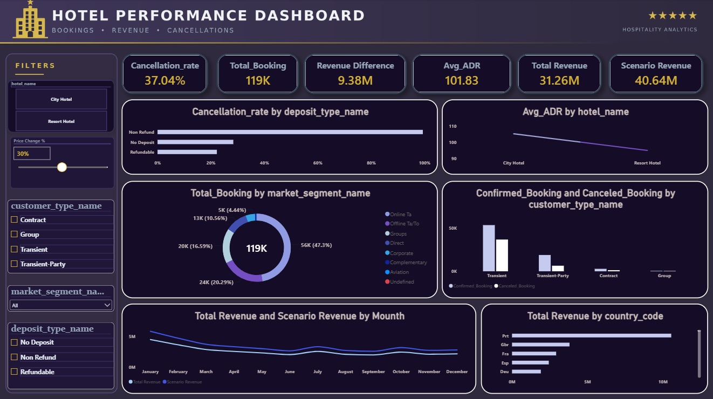

# Hotel Revenue Management & Dynamic Pricing Dashboard

A hotel booking analytics project built with SQL Server and Power BI to analyze bookings, cancellations, Average Daily Rate (ADR), and dynamic pricing scenarios.



## Business Problem and Objectives

Hotel revenue teams need to understand booking patterns, cancellation behavior, and room pricing to support better revenue management decisions.

This project aims to:
- Analyze booking volume and cancellation patterns.
- Compare Average Daily Rate (ADR) across hotel types.
- Identify booking segments and deposit types associated with cancellations.
- Explore how hypothetical price changes affect modeled revenue.

## Dataset

**Hotel Booking Demand** dataset from Kaggle.

- **Records:** 119,390
- **Columns:** 32
- **Source:** [Hotel Booking Demand — Kaggle](https://www.kaggle.com/datasets/jessemostipak/hotel-booking-demand)

The original dataset is not included in this repository. Download it from Kaggle before reproducing the analysis.

## Tools and Technologies

- SQL Server and SQL
- Microsoft Power BI
- DAX
- What-If parameter for dynamic pricing scenarios

## Project Workflow

1. Obtain the original CSV dataset from Kaggle.
2. Load and organize booking data in SQL Server.
3. Structure the database using `raw`, `dimensions`, and `facts` schemas.
4. Connect the data model to Power BI.
5. Build DAX measures, KPI cards, charts, and slicers.
6. Use the price-change parameter to explore hypothetical revenue scenarios.

**Workflow:** CSV → SQL Server → Power BI data model → DAX measures → Interactive dashboard.

## Key Findings

The following values were recomputed from the original CSV dataset.

| Metric | Result |
|---|---:|
| Total bookings | 119,390 |
| Overall cancellation rate | 37.04% |
| City Hotel cancellation rate | 41.73% |
| Resort Hotel cancellation rate | 27.76% |
| Average ADR | 101.83 |
| City Hotel average ADR | 105.30 |
| Resort Hotel average ADR | 94.95 |
| Non-Refund deposit cancellation rate | 99.36% |
| Groups segment cancellation rate | 61.06% |

These findings describe the original dataset. They should not be interpreted as proof that every value in the SQL database or Power BI model was independently validated.

## Dynamic Pricing Scenario

The dashboard includes a **Price Change %** parameter to explore the effect of hypothetical price adjustments on modeled revenue.

At a 30% price increase, the displayed scenario changes revenue from approximately **31.26M to 40.64M**, a difference of approximately **9.38M**.

This is a simplified scenario in which demand is held constant. It is **not a validated revenue forecast, a demand model, or a guarantee of increased profit**. The underlying DAX calculations require further validation before the scenario can support business decisions.

## Repository Structure

```text
Hotel-Revenue-Management-Dynamic-Pricing/
├── Data/
│   └── README.md
├── sql/
│   ├── hotel.sql
│   └── hotel_utf8.sql
├── powerbi/
│   ├── Final___Hotel.pbix
│   └── Dashboard/
│       └── dashboard.jpg
├── reports/
│   └── Hotel_Revenue_Management_Report.md
└── README.md
```

*This structure reflects the intended project files. Confirm the actual filenames and capitalization in the repository before publishing.*

## Reproduction

1. Download the original dataset from the Kaggle link above.
2. Follow the database setup instructions available in the repository.
3. Open `powerbi/Final___Hotel.pbix` using Power BI Desktop.
4. Configure the required data source and database connection.
5. Refresh the model and inspect the dashboard.

Reproduction may require additional database setup or data-loading steps, depending on the files available in the repository.

## Data Quality and Limitations

Initial profiling of the original CSV identified:

- 31,994 duplicate-looking rows.
- 180 rows with zero guests.
- 1,959 rows with an ADR of zero.
- Missing or placeholder values in several columns.

These observations require context before deciding whether rows should be removed or modified. The exact SQL cleaning process, final fact-table row count, and DAX measure definitions have not been independently verified.

The dashboard's displayed Total Revenue could not be reproduced from the original CSV using the tested calculations. Its exact calculation therefore remains to be confirmed.

## Team Contributions

The project was divided into five roles covering SQL ingestion, data modeling, DAX and KPIs, dynamic pricing scenario analysis, and dashboard design.

See Section 18 of the project report for the contribution breakdown.

## References

- Antonio, N., de Almeida, A., & Nunes, L. (2019). *Hotel booking demand datasets*. Data in Brief, 22.
- [Hotel Booking Demand dataset — Kaggle](https://www.kaggle.com/datasets/jessemostipak/hotel-booking-demand)
